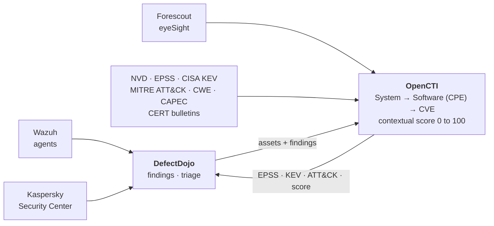

# OpenCTI Vulnerability Toolkit

A set of custom [OpenCTI](https://github.com/OpenCTI-Platform/opencti) connectors and
[DefectDojo](https://github.com/DefectDojo/django-DefectDojo) integration scripts that turn raw
CVE feeds into a prioritized, asset-aware vulnerability picture.

Public CVE feeds tell you that a vulnerability exists. They do not tell you whether it affects
anything you actually run, or which of the 40 000+ CVEs published each year deserve attention
first. This toolkit closes that gap: it links CVEs to the software and hosts in your estate, then
scores each one from exploitability and threat context so the queue sorts itself.

Everything here is vendor-neutral where it can be, and configured entirely through environment
variables. Nothing is tied to a particular organization or network.

## What it does



Two halves that work together:

**Connectors** run inside OpenCTI and build the knowledge graph. They attach CWE
classifications to CVEs, resolve CVEs to affected software via CPE, map CVEs onto MITRE ATT&CK
techniques, pull live asset inventory from Forescout and Kaspersky, and compute a single
contextual score per CVE.

**Pipeline scripts** run on a schedule outside OpenCTI. They import findings from Wazuh and
Kaspersky into DefectDojo, promote those findings into OpenCTI as asset relationships, then push
the resulting intelligence back onto the DefectDojo findings analysts actually work from.

## Components

### Connectors (`connectors/`)

All eight register with OpenCTI as `EXTERNAL_IMPORT` connectors and schedule themselves from
`CONNECTOR_DURATION_PERIOD`, so they re-run on an interval rather than firing on a single entity.

| Connector | What it produces |
|---|---|
| [`cve-score`](connectors/cve-score) | `x_opencti_score` (0–100) per CVE from CVSS, EPSS, ATT&CK tactic and threat-actor context |
| [`cve-attack-mapper`](connectors/cve-attack-mapper) | `CVE → related-to → ATT&CK Technique`, via CTID mappings and the CWE→CAPEC→ATT&CK chain |
| [`cve-cpe-mapper`](connectors/cve-cpe-mapper) | `Software → has → Vulnerability` from NVD CPE configurations |
| [`cwe-enrich-cna`](connectors/cwe-enrich-cna) | `x_opencti_cwe` from NVD CNA-assigned weaknesses |
| [`cve-affected-systems`](connectors/cve-affected-systems) | `x_opencti_affected_systems`, the aggregated host list per CVE |
| [`forescout-asset`](connectors/forescout-asset) | `System`, `IPv4-Addr` and `Software` objects from Forescout eyeSight |
| [`kaspersky-asset`](connectors/kaspersky-asset) | `System`, `IPv4-Addr` and `Software` objects from Kaspersky Security Center |
| [`dgssi-bulletin`](connectors/dgssi-bulletin) | `Report` objects from Moroccan CERT (DGSSI/maCERT) bulletins, linked to CVEs and assets |

### Pipeline scripts (`pipeline/`)

| Script | Direction | Purpose |
|---|---|---|
| [`wazuh-to-defectdojo`](pipeline/wazuh-to-defectdojo) | Wazuh → DefectDojo | Imports system vulnerabilities, one product per agent |
| [`kaspersky-to-defectdojo`](pipeline/kaspersky-to-defectdojo) | Kaspersky KSC → DefectDojo | Imports application vulnerabilities per managed device |
| [`defectdojo-to-opencti`](pipeline/defectdojo-to-opencti) | DefectDojo → OpenCTI | Creates `System` entities and links them to CVEs |
| [`opencti-to-defectdojo`](pipeline/opencti-to-defectdojo) | OpenCTI → DefectDojo | Writes EPSS, KEV, ATT&CK tags and score back onto findings |

Also included: [`wazuh-agent-install`](pipeline/wazuh-agent-install) for agent enrollment, and a
prebuilt [OpenCTI dashboard](dashboards/) covering CVE counts, EPSS coverage and KEV exposure.

## The data model

One modelling decision drives most of the toolkit, so it is worth stating plainly.

Asset-to-CVE exposure is represented as **`Software → has → Vulnerability`**, not the reverse.
A `has` relationship pointing from a Vulnerability to a Software observable is rejected by the
OpenCTI API, and only the Software-to-Vulnerability direction populates the *Affected software*
field in the UI. This matches how the official CISA KEV connector behaves.

Asset linkage then reads as a chain:

```
System ──related-to──▶ Software (CPE) ──has──▶ Vulnerability (CVE)
```

`cve-cpe-mapper` builds the right-hand link from NVD data. The asset connectors and
`defectdojo-to-opencti` build the left-hand one. Any connector that needs to know which hosts an
exposure touches walks this chain rather than storing its own copy.

## Getting started

You need a running OpenCTI instance (7.x) and, for the pipeline, a DefectDojo instance.

### Running a connector

Each connector directory holds a `Dockerfile`, a `requirements.txt` and, where applicable, a
`config.yml.sample`. Add the connector to your OpenCTI `docker-compose.yml`:

```yaml
  connector-cve-score:
    build: ./connectors/cve-score
    environment:
      - OPENCTI_URL=http://opencti:8080
      - OPENCTI_TOKEN=${OPENCTI_ADMIN_TOKEN}
      - CONNECTOR_ID=${CONNECTOR_CVE_SCORE_ID}
      - CONNECTOR_NAME=CVE Contextual Score
      - CONNECTOR_SCOPE=vulnerability
      - CONNECTOR_DURATION_PERIOD=PT6H
    restart: always
    depends_on:
      opencti:
        condition: service_healthy
```

Generate a distinct `CONNECTOR_ID` per connector with `uuidgen`. A missing or duplicated
`CONNECTOR_ID` is the most common reason a connector restarts in a loop.

```bash
docker compose up -d connector-cve-score
docker compose logs -f connector-cve-score
```

To force an immediate run, reset the connector state from **Data → Connectors** in the OpenCTI UI.

### Running a pipeline script

```bash
cd pipeline/wazuh-to-defectdojo
pip3 install -r requirements.txt
cp .env.example .env     # then fill in URLs and API tokens
python3 wazuh_to_defectdojo.py
```

Each script reads its configuration from a local `.env`, keeps incremental progress in a
`state.json`, and is safe to re-run. See [`pipeline/README.md`](pipeline/README.md) for the
scheduling order, which matters because the scripts feed each other.

## Requirements

- OpenCTI 7.x with a matching `pycti` version. `pycti` tracks the platform release, so the pin in
  each `requirements.txt` must match the OpenCTI version you run. Most components here pin
  `pycti==7.260326.0`; adjust them together rather than individually.
- Python 3.10 or newer
- DefectDojo 2.x for the pipeline scripts
- An NVD API key for `cwe-enrich-cna` and `cve-cpe-mapper`, which is
  [free to request](https://nvd.nist.gov/developers/request-an-api-key) and raises the rate limit
  from 5 to 50 requests per 30 seconds

Connectors that only read OpenCTI (`cve-score`, `cve-affected-systems`) need no external API key.

## Security

Configuration is read from environment variables and `.env` files, which `.gitignore` excludes.
Only `.env.example` and `config.yml.sample` are tracked, and they contain placeholders. Do not
commit a real `OPENCTI_TOKEN`, NVD key or Kaspersky service-account password.

The sample identifiers in the documentation (`00000000-0000-0000-0000-000000000000`) and the
example hostnames (`WIN-SRV-01`, `APP-SRV-01`, `mon-srv-01`) are placeholders, not real values.

## License

[MIT](LICENSE)
