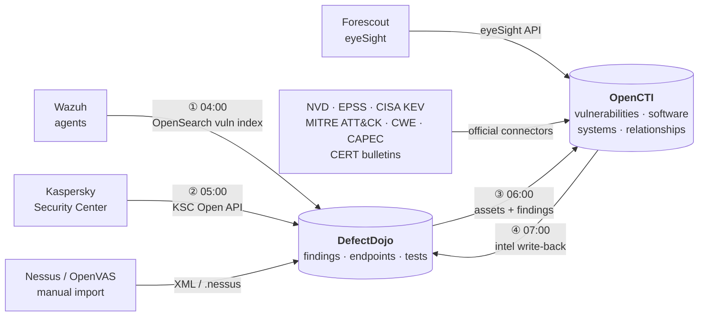
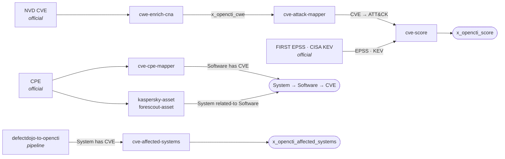

# Architecture

How the pieces fit together, and why the data flows in the direction it does.

## The problem

A CVE feed is a firehose. Over 48 000 CVEs were published in 2025, roughly 20% more than the year
before. Severity alone does not narrow that down usefully: a critical CVSS score on software you do
not run is noise, and a medium score on an internet-facing service under active exploitation is not.

Useful prioritization needs three things a raw feed does not provide:

1. **Exploitability in the wild.** Is anyone actually attacking this? EPSS gives a probability,
   CISA KEV gives a confirmed yes.
2. **Asset context.** Does this affect anything in the estate, and if so, what?
3. **Threat context.** Which ATT&CK techniques does it enable, and which threat actors use them?

This toolkit assembles all three in OpenCTI, reduces them to one score, then pushes the result to
where remediation actually gets tracked.

## Overall flow



## The data model

One decision shapes everything else, so it is worth being explicit.

Asset exposure is modelled as **`Software → has → Vulnerability`**, never the reverse. This is not
a stylistic choice. A `has` relationship pointing from a Vulnerability to a Software observable is
rejected outright by the OpenCTI API, and only the Software-to-Vulnerability direction populates the
*Affected software* field in the UI. The official CISA KEV connector builds its relationships the
same way.

Host-level exposure therefore reads as a two-hop chain:

```
System ──related-to──▶ Software (CPE) ──has──▶ Vulnerability (CVE)
```

Each link has an owner:

| Link | Built by |
|---|---|
| `Software → has → Vulnerability` | `cve-cpe-mapper`, from NVD CPE configurations |
| `System → related-to → Software` | `kaspersky-asset`, `forescout-asset` |
| `System → has → Vulnerability` | `defectdojo-to-opencti`, as a direct shortcut from scan findings |

Note the two routes to asset exposure. The asset connectors build the inferred chain through CPE
matching, which covers the whole inventory but depends on CPE data quality. The DefectDojo script
creates the direct `System → has → Vulnerability` edge from a confirmed scan finding, which is
narrower but authoritative. `cve-affected-systems` reads the direct edges when aggregating
`x_opencti_affected_systems`.

## Custom fields

The connectors write to these fields on `Vulnerability`:

| Field | Written by | Meaning |
|---|---|---|
| `x_opencti_cwe` | `cwe-enrich-cna` (and the official NVD connector) | CNA-assigned weakness classes |
| `x_opencti_score` | `cve-score` | Contextual risk, 0–100 |
| `x_opencti_affected_systems` | `cve-affected-systems` | Comma-separated host names |

`x_opencti_epss_score`, `x_opencti_epss_percentile`, `x_opencti_cisa_kev` and the CVSS fields come
from the official EPSS and KEV connectors.

## Scoring

`cve-score` reduces the graph to a single number per CVE using fixed weights:

```
score = (cvss/10) × 30 + epss_percentile × 40 + (tactic/30) × 20 + (apt/10) × 10
```

A CISA KEV listing overrides everything and sets the score to 100. Confirmed in-the-wild
exploitation outranks any combination of predicted indicators.

The weights are deliberately fixed rather than redistributed across available factors. Missing
factors contribute 0 to their slot, ATT&CK tactic falls back to a low default of 3/30, and APT count
defaults to 0. The effect is that **more context can only raise a score, never dilute it**. Under a
redistribution scheme, adding ATT&CK data to a CVE could lower its score by shrinking the CVSS and
EPSS shares, which makes scores incomparable between CVEs enriched to different depths.

EPSS carries more weight than CVSS (40 against 30) because it is a prediction about attacker
behaviour rather than a static description of the flaw. CVSS says how bad exploitation would be;
EPSS says how likely it is.

## Ordering and convergence

Several connectors depend on fields others write. Three independent tracks run inside OpenCTI,
each starting from an official connector:



Note that the asset connectors depend on the official CPE connector rather than on
`cve-cpe-mapper`: they match installed software against CPE observables that already exist. The two
build opposite halves of the same chain in parallel. `cve-affected-systems` sits on its own track
entirely, since it reads the direct `System → has → Vulnerability` edges written by
`defectdojo-to-opencti`, not the inferred chain.

`cve-score` runs a two-pass strategy to handle this: an incremental pass over recently modified
CVEs, plus a rescore pass over CVEs whose ATT&CK relationships changed since the last run. You do
not have to orchestrate the sequence by hand. On a steady schedule the graph converges after a
cycle or two.

The pipeline scripts are the exception. Their cron order genuinely matters, because each one reads
what the previous wrote within the same night. See [`../pipeline/README.md`](../pipeline/README.md).

## Idempotency

Nothing here is safe to run only once, so everything is safe to run repeatedly.

Connectors skip entities whose computed value already matches what is stored, which keeps the worker
queue short on steady-state runs. The pipeline scripts keep a `state.json` recording what they have
already pushed, so a re-run does not duplicate findings. Deleting a `state.json` forces a full
reprocess, which is occasionally what you want and otherwise an expensive mistake.
